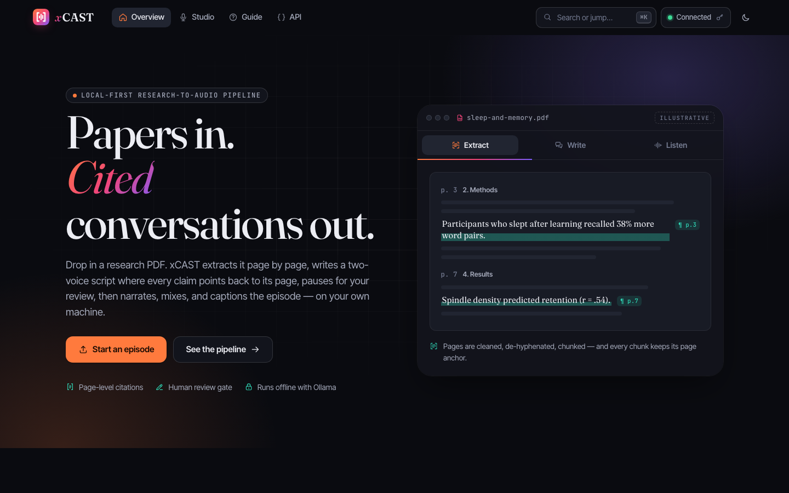
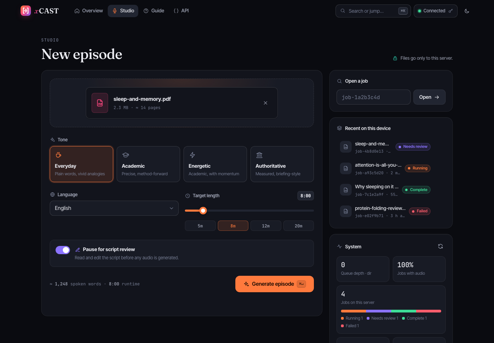
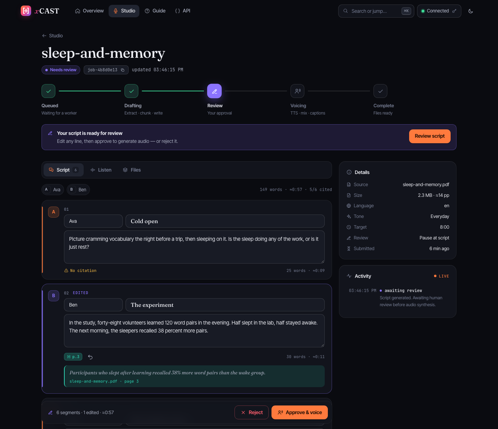
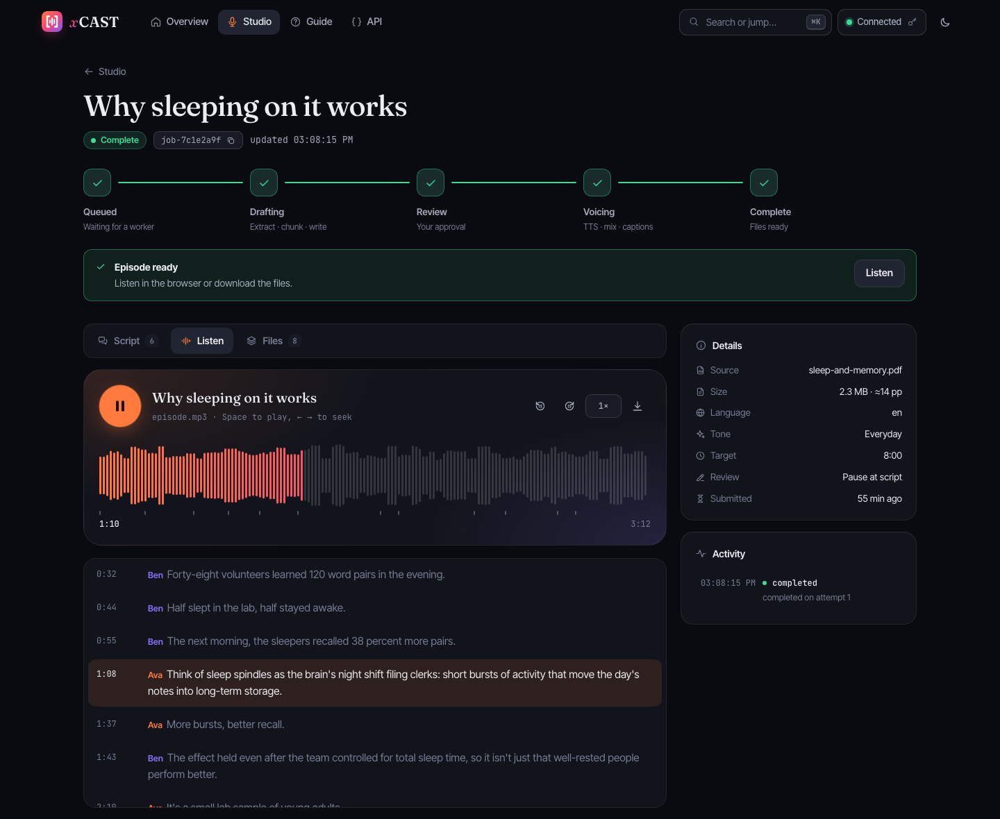
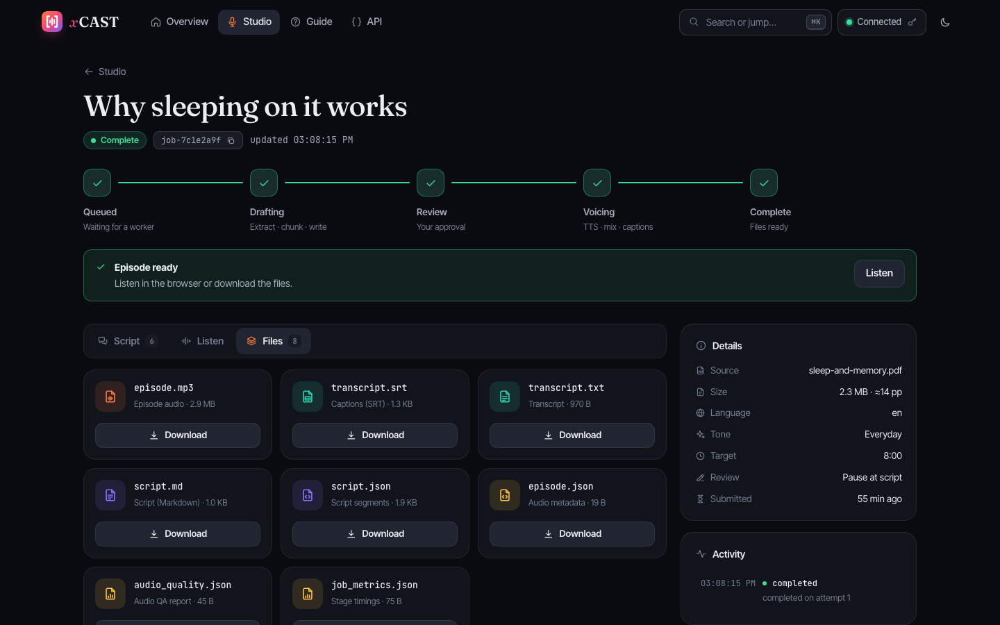
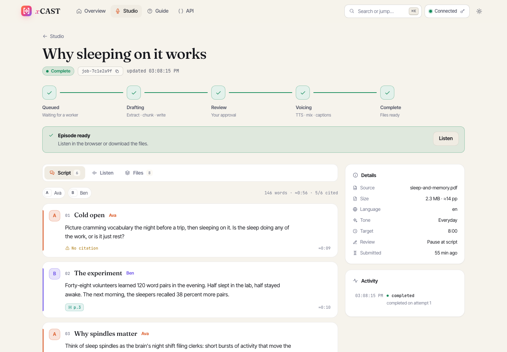
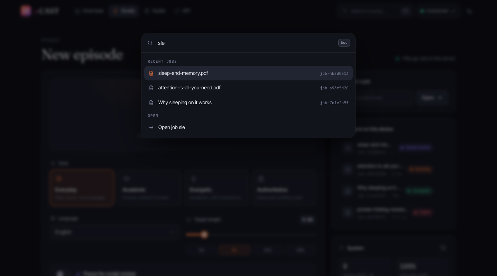
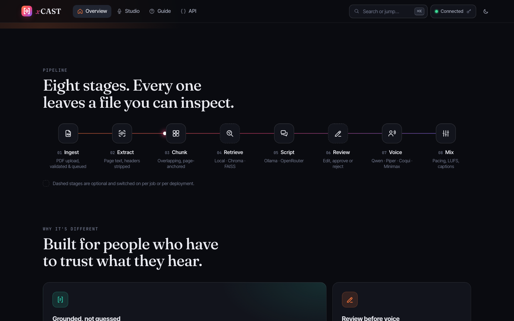
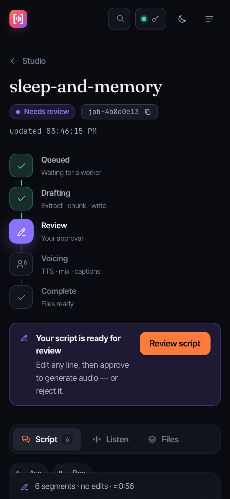
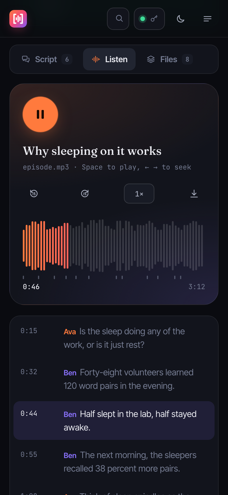

<p align="center">
  
</p>

<h1 align="center">xCAST: AI PDF-to-Podcast Generator &amp; Research Paper Narration Pipeline</h1>

<p align="center"><b>Papers in. Cited conversations out.</b></p>

[](https://github.com/KOKUTBON/xCAST/actions/workflows/ci.yml)
[](https://www.python.org/)
[](LICENSE)
[](https://fastapi.tiangolo.com)
[](https://docs.pydantic.dev/)
[](https://ollama.com)

<p align="center">
  
</p>

> **xCAST** is an open-source, local-first **AI podcast generator** and automated **PDF-to-podcast pipeline**. It converts complex research papers, academic PDFs, and technical documents into listener-ready audio discussions, citation-aware podcast scripts, synchronized transcripts, and SRT captions with pluggable text-to-speech (TTS) engines (CPU speech synthesis is included; see [provider support](docs/PROVIDER_SUPPORT.md) for external adapters).

---


## Table of Contents

- [About](#about)
- [Product Tour](#product-tour)
- [Why xCAST?](#why-xcast)
- [Core Features](#core-features)
- [Architecture & How It Works](#architecture--how-it-works)
- [Pipeline Outputs](#pipeline-outputs)
- [Requirements](#requirements)
- [Quick Start](#quick-start)
- [Docker Compose](#docker-compose)
- [CLI & Python SDK (`tic`)](#cli--python-sdk-tic)
- [Web Studio](#web-studio)
- [Configuration Reference](#configuration-reference)
- [Project Structure](#project-structure)
- [Development & Testing](#development--testing)
- [Security](#security)
- [Code of Conduct](#code-of-conduct)
- [Contributing](#contributing)
- [License](#license)

---

## About

Turning academic papers and technical documentation into engaging, understandable audio is challenging. Research documents are dense, equations and tables are hard to consume without visuals, and raw AI summaries often hallucinate or lose link back to the exact findings in the source text.

**xCAST** solves this by establishing a grounded, auditable, and modular **PDF-to-podcast pipeline**:
1. **Source Grounding**: Text is extracted page-by-page, indexed, and referenced with granular per-segment citations throughout the script.
2. **Multi-Speaker Narration**: Translates technical material into dynamic conversational segments between hosts, maintaining technical depth while optimizing for audio comprehension.
3. **Inspectable & Human-in-the-Loop**: Offers human-in-the-loop (HITL) review workflows where generated scripts can be reviewed, edited, and approved prior to launching speech synthesis.
4. **Local-First & Privacy-Focused**: Designed to run entirely on your own workstation or private infrastructure with local LLMs (Ollama) and local TTS engines (pyttsx3 or a separately reviewed external adapter), ensuring your proprietary documents never leave your server.

---

## Requirements

- **Python**: 3.11 or newer
- **LLM Provider**: [Ollama](https://ollama.com/) running locally (recommended: `llama3:instruct` or `qwen2.5:7b`), or an [OpenRouter](https://openrouter.ai/) API key
- **Audio Processing**: [FFmpeg](https://ffmpeg.org/) installed and available on system path (required for audio assembly)
- **Optional OCR**: Tesseract OCR for extracting text from scanned image PDFs
- **Optional Queue**: Redis 6+ (if utilizing `QUEUE_MODE=redis` for distributed execution)

---

## Quick Start

### 1. Clone & Set Up Virtual Environment

```bash
git clone https://github.com/KOKUTBON/xCAST.git
cd xCAST
python3 -m venv .venv
source .venv/bin/activate
pip install --upgrade pip
pip install -e libs/contracts -e libs/podcast -e libs/client -e services/api -e services/worker
```

### 2. Configure Environment & Pull Local Model

```bash
cp services/api/.env.example services/api/.env
cp services/worker/.env.example services/worker/.env

# Pull the default local LLM with Ollama
ollama pull llama3:instruct
```

### 3. Launch Services

Start the API service in one terminal:
```bash
source .venv/bin/activate
uvicorn podcastify_api.main:app --reload --port 8000
```

Start the background worker in a second terminal:
```bash
source .venv/bin/activate
python -m podcastify_worker.main
```

### 4. Generate Your First Podcast

Navigate to **<http://localhost:8000>** in your browser to access the interactive Web Studio, or run the CLI:

```bash
tic submit path/to/paper.pdf --language en --style everyday --minutes 8 --wait --download ./output
```

---

## Docker Compose

Run the entire self-hosted stack (API + Worker + Redis + Ollama) in containerized environments:

```bash
docker compose up --build -d
docker compose exec ollama ollama pull llama3:instruct
```

Access endpoints:
- **Web Studio**: <http://localhost:8000>
- **API Documentation**: <http://localhost:8000/docs>
- **Health Check**: <http://localhost:8000/health>

For production deployment instructions and security hardening, consult the [Docker Guide](infra/docker/README.md).

---

## Product Tour

Every screen below is the real Web Studio served by the API at `http://localhost:8000`, captured against a running server with sample jobs.

### 1. Start an episode

Drop in a PDF and xCAST checks it is really a PDF and estimates its page count before upload. Pick a tone, a target length (with a live spoken-word estimate) and a language, and choose whether to pause for human review. The sidebar keeps recent jobs on this device and shows live server metrics.



### 2. Review the script before any audio is made

The job workspace tracks each stage live over Server-Sent Events. When the script is ready, every segment becomes editable: speaker, title and narration, with word counts and timing estimates. Citation chips open the exact supporting snippet and page. Edited segments are marked and can be undone, and the sticky bar approves the script for voicing or rejects it with a note.



### 3. Listen with synced captions

The finished episode plays in the browser. The waveform is decoded from the actual audio, and you can click or drag to seek, change speed, or skip ±15 s. Captions from `transcript.srt` highlight as the audio plays, and clicking any line jumps to it.



### 4. Take every artifact with you

Each output (`episode.mp3`, captions, transcript, Markdown and JSON script, QA and timing reports) is one click away.



### More

| Light "paper" theme | Command palette (`⌘K` / `Ctrl K`) |
| :---: | :---: |
|  |  |

| The eight-stage pipeline | On mobile |
| :---: | :---: |
|  |   |

---

## Why xCAST?

| Feature | xCAST | Generic AI Summarizers / Cloud Tools |
| :--- | :--- | :--- |
| **Data Privacy** | 100% self-hosted & local-first (Ollama, local TTS) | Cloud-only; proprietary data uploaded to third parties |
| **Citation Rigor** | Page-level source tracing & evidence verification | Black-box summaries without source attribution |
| **Human-in-the-Loop** | Built-in pause & edit review stage before audio generation | All-or-nothing generation without manual approval |
| **Modular Extensibility** | Pluggable LLM, Vector RAG, Queue, Storage, and TTS backends | Locked into single proprietary vendor APIs |
| **Developer Ergonomics** | REST API + SSE progress + Python SDK + `tic` CLI + Web Studio | Web dashboard only or rigid webhook setups |

---

## Core Features

- **Accurate Document Extraction**: Page-level PDF extraction with header/footer cleanup, de-hyphenation, and citation preservation.
- **RAG & Vector Grounding**: Optional retrieval-augmented generation using the local store; external model/database adapters require a separate security review.
- **Citation-Backed Scripting**: Produces structured episode dialogue tagged with exact source pages and supporting snippets.
- **Pluggable LLM Adapters**: Out-of-the-box support for Ollama (local Llama 3, Mistral, Qwen) and OpenRouter.
- **Extensible Speech Synthesis**: CPU speech synthesis with provider interfaces for separately reviewed integrations.
- **Professional Audio Assembly**: Automated multi-speaker stitching, loudness normalization (-16 to -14 LUFS / dBFS matching), silence insertion, and QA metadata generation.
- **Human-in-the-Loop Content Review**: Optional pause at the script stage to inspect, edit, approve, or reject dialogue via Web Studio, REST API, or CLI.
- **Reliable Task Queues**: Flexible queue backend supporting local directories, files, or distributed Redis sorted sets with retry backoff and dead-letter queues.
- **Pluggable Artifact Storage**: Store generated scripts and audio files on local disk or S3-compatible object storage (AWS S3, MinIO, Cloudflare R2).
- **Multi-Interface Access**: Full REST API with OpenAPI documentation, real-time Server-Sent Events (SSE), Web Studio UI, typed Python SDK, and the `tic` CLI.

---

## Architecture & How It Works

```text
       ┌────────────────────────┐
       │   Input Research PDF   │
       └───────────┬────────────┘
                   │
                   ▼
       ┌────────────────────────┐
       │  Extraction & Cleanup  │  ◄── Page-level text extraction, OCR, de-hyphenation
       └───────────┬────────────┘
                   │
                   ▼
       ┌────────────────────────┐
       │ Chunking & Vector RAG  │  ◄── Dense chunks, BM25 / local retrieval
       └───────────┬────────────┘
                   │
                   ▼
       ┌────────────────────────┐
       │ Script Generation LLM  │  ◄── Ollama / OpenRouter: multi-host dialogue & citations
       └───────────┬────────────┘
                   │
                   ▼
       ┌────────────────────────┐
       │ Quality & Hallucination│  ◄── Citation integrity, length, and content checks
       └───────────┬────────────┘
                   │
                   ▼
       ┌────────────────────────┐
       │ Human Review (Optional)│  ◄── Pause, review, edit segments via Web UI or CLI
       └───────────┬────────────┘
                   │
                   ▼
       ┌────────────────────────┐
       │   TTS Voice Synthesis  │  ◄── CPU TTS / reviewed external providers
       └───────────┬────────────┘
                   │
                   ▼
       ┌────────────────────────┐
       │ Professional Mastering │  ◄── Loudness normalization, silence pacing, QA report
       └───────────┬────────────┘
                   │
                   ▼
 ┌────────────────────────────────────────────────────────┐
 │ Final Deliverables: episode.mp3, script.md, transcript │
 └────────────────────────────────────────────────────────┘
```

The system uses a decoupled Clean Architecture monorepo:
* **`services/api`**: FastAPI service handling uploads, validation, idempotent job creation, SSE progress streaming, and artifact downloads.
* **`services/worker`**: Autonomous background worker executing PDF ingestion, script synthesis, TTS generation, and audio mastering.
* **`libs/podcast`**: Core business domain engine containing use cases, entities, and storage/TTS adapters.
* **`libs/contracts`**: Immutable Pydantic data schemas shared across API, worker, and client.
* **`libs/client`**: Python client library and `tic` command-line utility.

For architectural depth, explore:
- [System Architecture](docs/architecture.md)
- [System Design Document](docs/system_design.md)
- [Object-Oriented Design](docs/oo_design.md)
- [Design Patterns](docs/design_patterns.md)
- [Architectural Decision Records (ADRs)](docs/adr/)

---

## Pipeline Outputs

Every processed job generates a structured package in `data/processed/<job_id>/` (or in configured S3 buckets):

| Output Artifact | Format | Description |
| :--- | :--- | :--- |
| `script.md` | Markdown | Listener-ready podcast script with speaker markers and chapter headers |
| `script.json` | JSON | Structured segments with page-level citations and speaker metadata |
| `transcript.txt` | Plain Text | Full linear episode transcript |
| `transcript.srt` | SubRip SRT | Synchronized subtitle transcript for video or captioning workflows |
| `quality.json` | JSON | Automated QA assessment: citation coverage, evidence ratio, and duration audit |
| `job_metrics.json` | JSON | Detailed timings for every stage (extraction, scripting, synthesis, assembly) |
| `episode.mp3` | MP3 Audio | Broadcast-ready mastered podcast episode |
| `audio_quality.json` | JSON | Post-mastering loudness compliance and sample rate report |

---


## CLI & Python SDK (`tic`)

The `podcastify-client` package provides both a terminal CLI and a typed Python client.

### Terminal CLI (`tic`)

```bash
# Submit a research paper and download the finished MP3
tic submit attention_is_all_you_need.pdf --minutes 10 --wait --download ./episodes

# Submit a job with a Human-in-the-Loop review pause
tic submit paper.pdf --pause-at-script

# Check execution status or stream real-time progress
tic status job-a1b2c3d4
tic watch job-a1b2c3d4

# Read generated script
tic script job-a1b2c3d4 --raw

# Approve or reject paused script
tic review job-a1b2c3d4 approve --notes "Reviewed and approved"
tic review job-a1b2c3d4 approve --segments-file edited_segments.json

# Download a specific artifact
tic download job-a1b2c3d4 episode.mp3 -o ./final_podcast.mp3
```

### Programmatic Python SDK

```python
from podcastify_client import ThinkingInCodeClient

with ThinkingInCodeClient(base_url="http://localhost:8000") as client:
    # 1. Submit PDF
    job = client.submit_job(
        "arxiv_paper.pdf",
        language="en",
        style="everyday",
        target_minutes=8,
        pause_at_script=True,
    )
    job_id = job["job_id"]
    print(f"Submitted job: {job_id}")

    # 2. Wait for script generation pause
    status = client.wait_for_completion(job_id, stop_on_review=True)
    if status.get("status") == "awaiting_review":
        script = client.get_script(job_id)
        print(f"Generated {len(script['segments'])} dialogue segments.")

        # 3. Approve and resume audio synthesis
        client.submit_review(job_id, action="approve", notes="Looks great!")

    # 4. Stream real-time progress events until complete
    for event in client.stream_progress(job_id):
        print(f"[{event.get('status')}] {event.get('stage')}: {event.get('detail', '')}")

    # 5. Download final episode audio
    client.download_artifact(job_id, "episode.mp3", "output/episode.mp3")
```

---

## Web Studio

A browser-only GitHub Pages demo is ready to build with `python3 scripts/build_demo.py`. Preview `dist/pages/` with a static server. It includes simulated review workflows and a prerecorded sample; no API or worker is needed. See [demo setup and manual publishing instructions](demo/README.md). Publishing is opt-in through a manual workflow.

The built-in Web Studio is served at `/` from the API service. It is a dependency-free ES-module app (no build step) with a dark "studio" theme and a light "paper" theme. See the [Product Tour](#product-tour) for screenshots.

- **Studio** (`/#/studio`): drag-and-drop PDF upload with real upload progress, page-count preview, tone cards, a length slider with a spoken-word estimate, and an optional script-review pause. Recent jobs are remembered on this device, and a panel shows live server metrics.
- **Job workspace** (`/#/job/<id>`): live stage tracking over Server-Sent Events (or polling when an API key is set), an activity log, and an inline **script reviewer**. You can edit speakers, titles, and narration, see page-level citation snippets, then approve or reject with a note.
- **Listen**: an in-browser player with a decoded waveform, click-to-seek, speed control, and SRT captions synced to playback. Every artifact can be downloaded from **Files**.
- **Command palette** (`⌘K` / `Ctrl K`) to jump anywhere or open a job by ID. The API key is held in memory for the tab only and never put in a URL or browser storage.

---

## Configuration Reference

Configure services via `.env` files or environment variables. Reference files: [`services/api/.env.example`](services/api/.env.example) and [`services/worker/.env.example`](services/worker/.env.example).

| Category | Variable | Default | Description |
| :--- | :--- | :--- | :--- |
| **API Security** | `API_KEY` | *empty* | Optional shared secret; if set, requires `X-API-Key` or `Authorization: Bearer` |
| | `UPLOAD_MAX_BYTES` | `31457280` | Maximum upload size in bytes (default 30 MB) |
| **Queue** | `QUEUE_MODE` | `dir` | Queue provider: `dir`, `file`, or `redis` |
| | `QUEUE_REDIS_URL` | `redis://localhost:6379/0`| Connection URL for Redis queue |
| | `QUEUE_REDIS_KEY` | `podcastify:jobs:priority` | Sorted set key for queued jobs |
| **LLM Engine** | `SCRIPT_PROVIDER` | `ollama` | Script generation engine: `ollama` or `openrouter` |
| | `OLLAMA_BASE_URL` | `http://localhost:11434` | Ollama service endpoint |
| | `OLLAMA_MODEL` | `llama3:instruct` | Default LLM model identifier |
| | `OPENROUTER_API_KEY` | *empty* | API key for OpenRouter models |
| **TTS & Audio** | `ENABLE_TTS` | `false` | Enable or disable text-to-speech audio synthesis |
| | `ENABLE_AUDIO` | `false` | Enable or disable audio mixing and mastering |
| | `TTS_PROVIDER` | `pyttsx3` | Supported default: `pyttsx3`; see [provider policy](docs/PROVIDER_SUPPORT.md) for external adapters |
| | `AUDIO_TARGET_DBFS`| `-16.0` | Target loudness normalization in dBFS/LUFS |
| **Storage** | `STORAGE_BACKEND` | `fs` | Artifact backend: `fs` (local) or `s3` (S3/MinIO/R2) |
| | `STORAGE_S3_BUCKET`| *empty* | Bucket name when using S3 storage |
| **Worker Reliability**| `MAX_JOB_ATTEMPTS` | `3` | Maximum retry attempts before routing to dead-letter queue |
| | `WORKER_MAX_CONCURRENT` | `2` | Maximum concurrent jobs processed per worker instance |

---

## Project Structure

```text
├── libs/
│   ├── contracts/          # Stable Pydantic schemas (JobStatus, EpisodeSegment, Review)
│   ├── podcast/            # Clean architecture core engine (extract, chunk, script, audio)
│   └── client/             # Official Python SDK and 'tic' command-line client
├── services/
│   ├── api/                # FastAPI HTTP service, SSE endpoints, and Web Studio
│   └── worker/             # Background daemon polling and processing jobs
├── prompts/                # LLM prompting templates for scriptwriting and evaluation
├── scripts/                # CLI maintenance utilities (purge_stale_artifacts, redis_push)
├── docs/                   # Architecture, system design, ADRs, design specs, and screenshots
├── assets/branding/        # Logos, favicons, app icons, and social previews
├── docker-compose.yaml     # Local multi-service development compose definition
└── Makefile                # Developer orchestration shortcuts (bootstrap, test, lint)
```

---

## Development & Testing

```bash
# Activate virtual environment
source .venv/bin/activate

# Run code style formatting and linting
ruff check .
ruff format --check .

# Run complete test suite (unit, pipeline, API, storage, and worker tests)
pytest -q
```

Continuous integration runs on all pull requests against Python 3.11 with Ruff and Pytest verification.

---

## Security

xCAST is designed for self-hosted and internal environments:
- When exposed across networks, configure `API_KEY` to require token authentication on all endpoints. Note that `api_key` in URL query parameters is rejected to prevent credential leaks in web logs.
- In production, place the service behind a reverse proxy (e.g., Traefik, Caddy, Nginx) with HTTPS/TLS termination, rate limiting, and network access controls.
- To report a security vulnerability, please review our coordinated disclosure process in [SECURITY.md](SECURITY.md). Do not disclose security issues in public issues or discussion forums.

---

## Code of Conduct

We are committed to providing a welcoming, inclusive, and harassment-free community for all contributors and maintainers. Participation in project repositories, issues, discussions, and pull requests is governed by our [Code of Conduct](CODE_OF_CONDUCT.md).

---

## Contributing

We welcome community contributions, including bug fixes, documentation improvements, new TTS adapters, vector retrieval backends, and performance enhancements!

To get started:
1. Review [CONTRIBUTING.md](CONTRIBUTING.md) for detailed environment setup, development conventions, and architecture principles.
2. Fork the repository and create a feature branch (`git checkout -b feature/my-feature`).
3. Ensure all tests pass (`pytest -q`) and code is formatted with Ruff (`ruff check .` and `ruff format .`).
4. Submit a descriptive Pull Request referencing any related issues.

---

## License

This project is licensed under the **[MIT License](LICENSE)**. You are free to use, modify, distribute, and sublicense this software, subject to the inclusion of the original copyright notice and permission terms.

## KOKUTBON community and support

Open technology for the benefit of humankind — built by people, for people, and freely reusable by everyone.

Read [Contributing](CONTRIBUTING.md), [Code of Conduct](CODE_OF_CONDUCT.md), [Support](SUPPORT.md), [Governance](GOVERNANCE.md) and [Security](SECURITY.md). Help sustain the work through [GitHub Sponsors and other contributions](SPONSORSHIP.md). Maintainer release requirements are documented in [Release checklist](RELEASE_CHECKLIST.md).

## Source publication

See [source publication status](SOURCE_PUBLICATION.md) and [local validation record](PUBLICATION_VALIDATION.md) for the initial distribution and remaining release checks.
