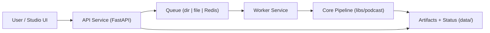

# System Design

## Goals

- Convert research PDFs into cited podcast artifacts.
- Keep execution local-first and reproducible.
- Support pluggable model/audio providers without core rewrites.
- Provide operational safety: validation, retries, dead-letter, observability.

## Runtime topology

## Request and processing flow

1. `POST /v1/jobs` receives upload and validates size/type/content signature.
2. API writes input + `request.json` + initial `status.json`.
3. API enqueues job ID and returns response (supports `Idempotency-Key` replay).
4. Worker dequeues and claims job lock to prevent duplicate execution.
5. Worker runs pipeline and writes script/transcript/quality/audio artifacts.
6. On failure, worker retries with backoff until `MAX_JOB_ATTEMPTS`.
7. Final failure writes a dead-letter payload to `data/dead_letter/`.
8. API serves status, SSE progress, metrics summary, and artifact downloads.

## Data model (filesystem)

- `data/jobs/<job_id>/request.json`: immutable job request.
- `data/jobs/<job_id>/status.json`: mutable execution state.
- `data/jobs/<job_id>/attempt.json`: worker attempt tracking.
- `data/jobs/<job_id>/claim.lock`: in-flight claim guard.
- `data/processed/<job_id>/`: generated outputs and metrics.
- `data/dead_letter/<job_id>-<timestamp>.json`: exhausted failures.
- `data/idempotency/<hash>.json`: idempotency key mapping.

## Concurrency and scaling

- Queue backend is selectable: `dir`, `file`, `redis`.
- Worker concurrency is controlled by `WORKER_MAX_CONCURRENT`.
- Claim lock + stale timeout (`JOB_CLAIM_STALE_S`) prevents duplicate processing.
- Multiple worker instances are supported when using shared storage + queue backend.

## Reliability controls

- API-side hardening:
  - PDF signature and extension validation.
  - upload size limit (`UPLOAD_MAX_BYTES`).
  - idempotent submission replay via `Idempotency-Key`.
- Worker-side hardening:
  - bounded retries (`MAX_JOB_ATTEMPTS`).
  - exponential retry backoff (`RETRY_BACKOFF_S`).
  - dead-letter persistence for incident triage.

## Observability and operations

- Metrics:
  - queue depth gauge.
  - job success/failure counters.
  - stage timing histograms.
- Artifacts:
  - `job_metrics.json`, `quality.json`, `quality.log`, optional `audio_quality.json`.
- Logging:
  - plain/json formats and correlation IDs per job.
